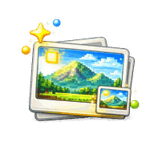
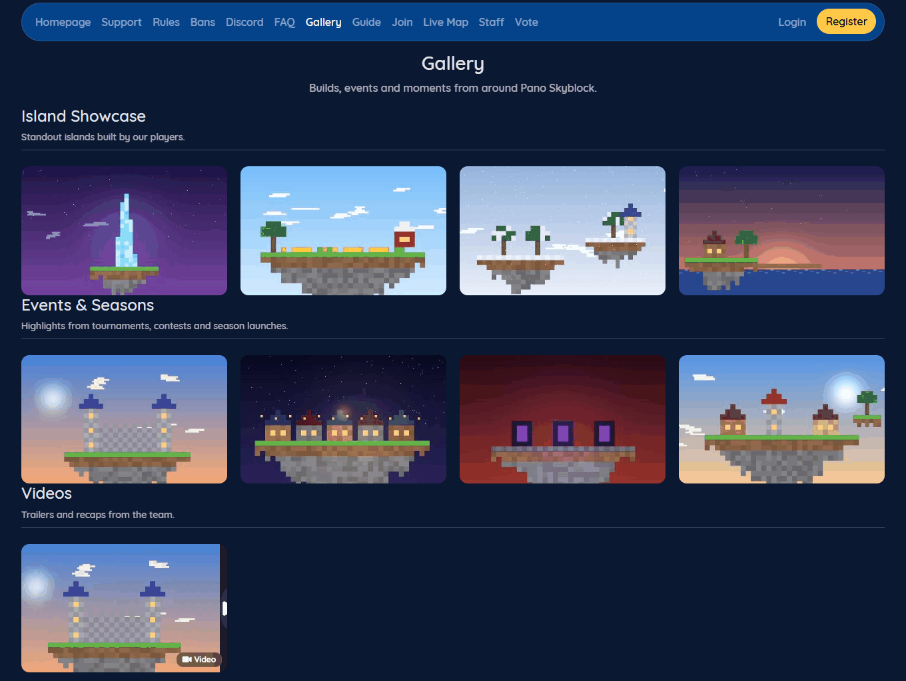
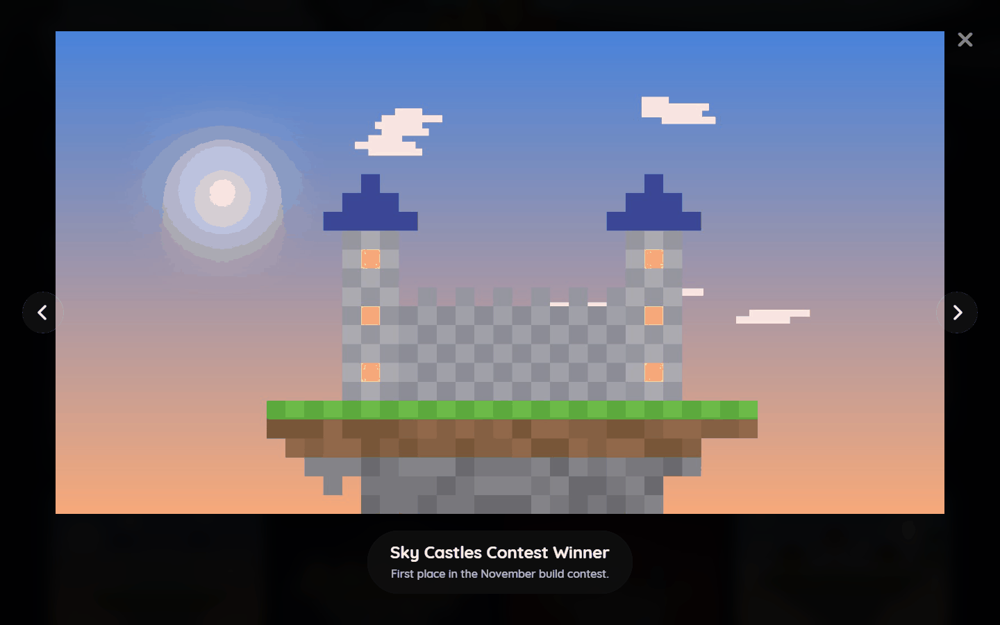
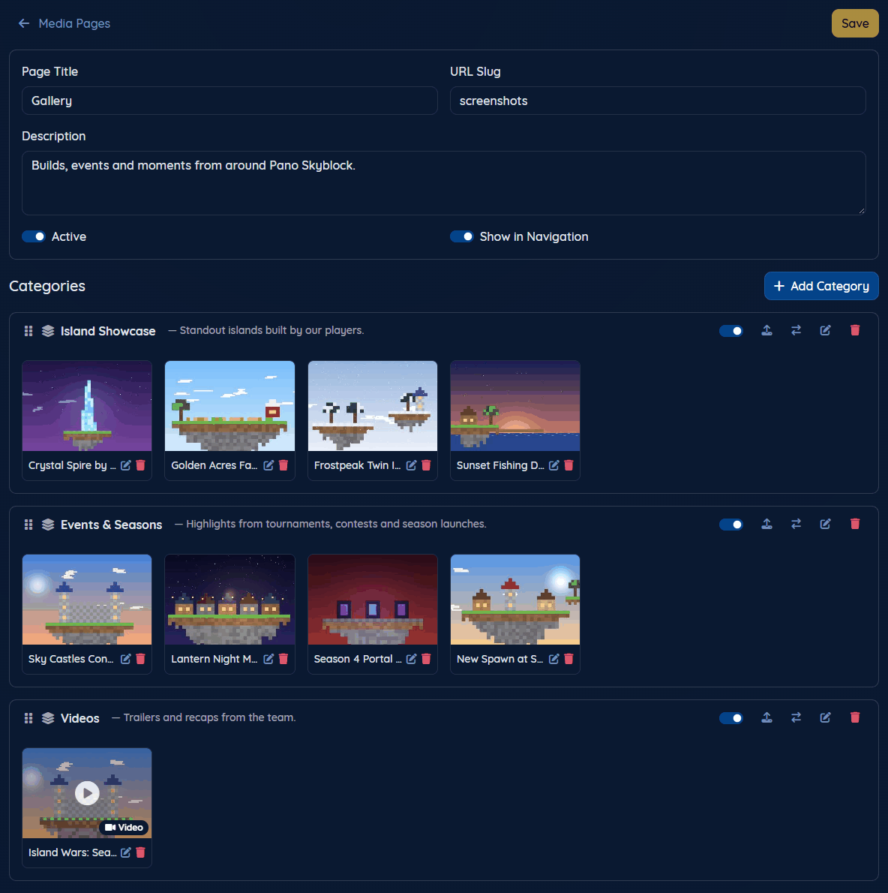

  
  <h1>Media Page</h1>
  
<b>Show off your best builds, events and trailers in a beautiful gallery.</b>

  

    
    
    
  

Media Page lets you create gallery pages on your website for screenshots, builds and videos. Group your media into categories, add titles and descriptions, and players can browse everything in a clean grid with a full-screen viewer.

## ✨ Features
- 🖼️ **Gallery pages**: Create as many gallery pages as you like, each with its own link.
- 🗂️ **Categories**: Group your media into sections like builds, events or videos.
- 🎬 **Images and videos**: Upload pictures and video clips side by side.
- 🔍 **Full-screen viewer**: Players click any item to see it large and flip through the rest.
- ↕️ **Easy ordering**: Drag categories and media into the order you want.
- 👁️ **Show or hide**: Hide a category or a whole page until it is ready.
- 🧭 **Menu link**: Add a gallery to your website's menu with one switch.

## 📸 Screenshots

<i>Players click any item to view it full screen and flip through the gallery.</i>

<i>Manage pages, categories and uploads from the panel.</i>

## 🚀 Get started
1. Open your Pano panel and go to **Addons**.
2. Find **Media Page** and click **Install**.
3. Open **Media** in the panel menu, click **Create Page**, add categories and upload your media.

## 💬 Support
Questions or ideas? Join our [Discord](https://panomc.com/discord) or visit [panomc.com](https://panomc.com).

## 📄 License
Released under the MIT License.
